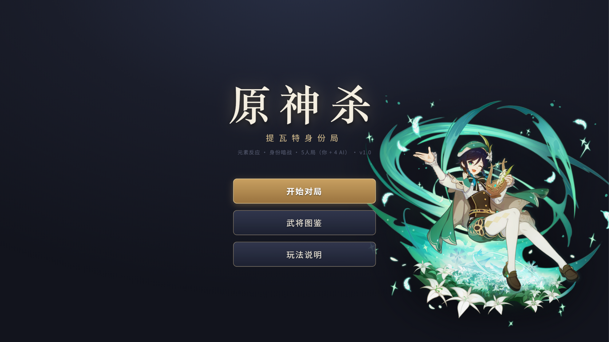
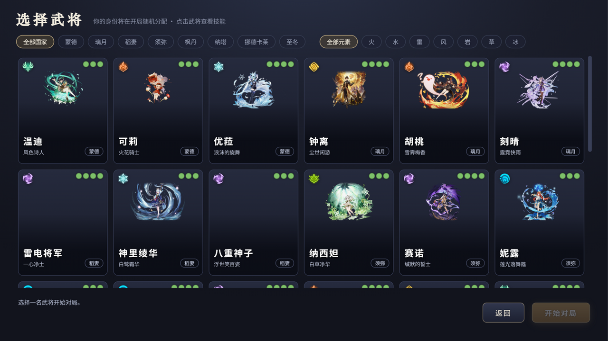

# 七国杀 · Seven Nations Clash

> 提瓦特元素身份局 —— 「三国杀」玩法骨架 × 「原神」七国世界观的同人卡牌游戏
> A Genshin-flavored Sanguosha (Legends of the Three Kingdoms) hidden-role card game, in a single HTML file.



## 这是什么 / What is this

**《七国杀》** 是一款单文件 HTML 卡牌对战游戏：5 人身份局（你 + 4 AI），把魏蜀吴群替换为提瓦特八阵营，引入**元素附着与反应系统**——像在原神里一样「挂元素、打反应」。

**Seven Nations Clash** is a self-contained HTML card game: a 5-player hidden-identity battle (you + 4 AI) set in Teyvat, featuring an elemental attachment & reaction system inspired by Genshin Impact.



## 特性 / Features

- 🎴 **5 人身份局**：主公 / 忠臣 / 反贼×2 / 内奸，主公体力上限 +1 —— Lord / Loyalist / Rebel ×2 / Spy
- ⚡ **元素反应**：蒸发 / 融化 / 激化（伤害+1）、超载（弃牌）、超导（碎装备）、感电（蔓延）、冻结（禁闪）、绽放（延时爆发）、结晶（护盾）、扩散（传播附着）—— Vaporize / Melt / Quicken / Overload / Superconduct / Electro-Charged / Frozen / Bloom / Crystallize / Swirl
- 🌙 **25 名武将**：蒙德 / 璃月 / 稻妻 / 须弥 / 枫丹 / 纳塔 / 挪德卡莱 / 至冬，含 6.x–7.x 新角色（菈乌玛、菲林斯、爱诺、哥伦比娅、玛薇卡、阿罗夏、奥黛塔、沃雅妮莎……），每人专属技能
- 🖱️ **拖拽出牌**：卡牌拖到角色头上即对其出牌，拖到上方区域直接使用
- 🏮 **原神风格 UI**：千星奇域 UGC 素材库图元（三/九宫格拉伸）+ 官方透明底立绘

## 运行 / Run

**双击 `七国杀.html` 即可游玩**（推荐 Chrome/Edge，窗口 ≥1180px）。角色立绘在 `assets/render` 与 `assets/face`，与 HTML 保持相对路径即可；没有这些图片时游戏自动降级为纯色卡面，逻辑不受影响。

Just open `七国杀.html` in a modern browser. Keep the `assets/` folder next to it for portraits; the game degrades gracefully without them.

```
python -m http.server 8763   # 可选：本地预览服务器 / optional local server
# 访问 http://127.0.0.1:8763/七国杀.html
```

## 重新构建 / Build from source

源码在 `tools/`（shell.html + game.css + game_data/engine/ai/ui/main.js）：

```bash
node tools/build.mjs   # 生成单文件 七国杀.html（内嵌 116 张 UI 素材 base64）
```

## 文档 / Docs

| 文档 | 内容 |
|---|---|
| [策划案.md](策划案.md) | 设计文档：世界观映射 / 元素反应表 / 120 张牌堆 / 25 武将技能 / AI / UI 规范 |
| [交付说明.md](交付说明.md) | 玩家向运行与操作说明 |
| [交接文档.md](交接文档.md) | 开发者交接：架构 / 素材体系 / 踩坑记录 / 迭代建议 |

## 目录 / Layout

```
七国杀.html          # 游戏本体（single-file build）
assets/render/       # 官方透明底抽卡立绘（选将/图鉴）
assets/face/         # 官方头像（对局座位）
assets/portraits/    # 官方立绘原图（备份）
ugc-assets/          # 千星奇域 UGC 素材库全量副本（1522 图元+元数据，构建自包含）
tools/               # 源码与构建脚本
docs/                # 预览截图
```

## 版权 / License notice

《原神》角色立绘与名称 © miHoYo / HoYoverse。本项目为个人学习研究用途的同人作品，**不得用于商业用途**。
Genshin Impact and its assets are trademarks of miHoYo / HoYoverse. This is a non-commercial fan project for personal study only.
`ugc-assets/` 为千星奇域 UGC 编辑器公开素材库副本，仅随本工具生态用于个人学习研究。
